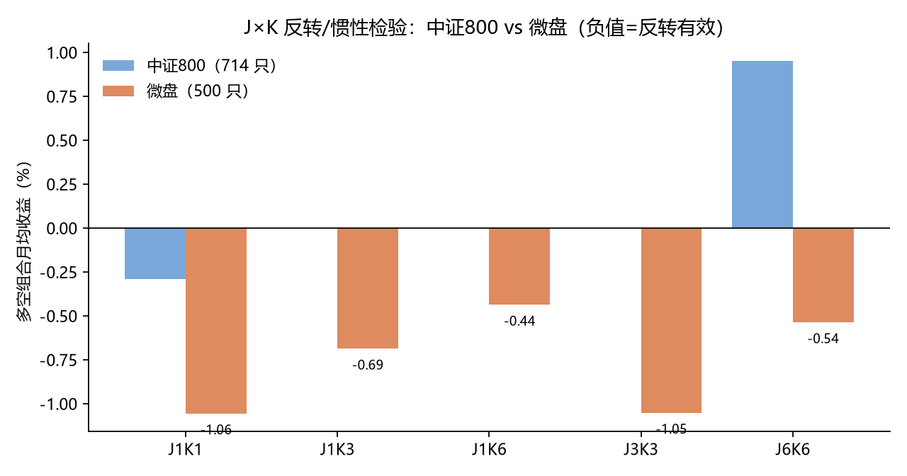

# A股反转效应的宇宙依赖性：中证800 与微盘股的对照复现

> 潘莉、徐建国（2011）说 A 股在多个频率上存在显著反转。这份研究用同一套 J×K 方法在 2015–2026 重做了一遍：
> **中证800 里反转没了，微盘里还在——但补进退市股之后，微盘的显著性也消失了。**
> 最后又把它做成能下单的原型，结论是：**信号是真的，可收割的那一半被制度拿走了。**

一份「从复现到证伪」的完整记录：2 个宇宙 × 两套 t 值口径 × 生存偏差检验 × 退市预警过滤 × 多头原型实测。

## 核心结果

### 1. 反转搬了家（月频多空，%/月；负值 = 反转有效）

| J（形成期） | K（持有期） | 中证800 714 只 | 微盘 500 只 |
|---|---|---|---|
| 1 | 1 | −0.29（t −0.40） | **−1.06（t −2.33）** |
| 1 | 3 | — | −0.69（t_nb −2.22） |
| 3 | 3 | — | **−1.05（t_nb −3.07）** |
| 6 | 6 | +0.95（t_nb 1.75，不显著） | −0.54（t_nb −2.83） |

`t_nb` = 非重叠 t。K>1 时相邻样本有 K−1/K 的重叠，直接计算 t 会系统性放大——**所有表都同时给出两个 t**。

### 2. 但七成是生存偏差

把 2015 年后退市的 110 只股票补进来（退市前最后 6 个月平均再跌 60%），微盘 J=3/K=3 从 **−1.053% → −0.766%，t_nb −3.07 → −1.33**：显著性消失。

### 3. 唯一站得住的版本：加退市预警过滤

用「距历史最高点的比例」当过滤器，剔除崩塌档（<30%）之后：**J=3/K=3 −1.05%/月，t_nb −2.44**。

### 4. 做成策略依然亏（原型代码不公开，仅给结果）

610 只（含退市）、季度轮动、ADV 上限、费用全开：

| 版本 | 年化 | 最大回撤 |
|---|---|---|
| 过滤 + 60 只 | −8.83% | −72.41% |
| 无过滤 + 30 只 | −19.27% | −93.93% |
| **全池等权基准** | **+4.30%** | −61.81% |

原因：把多空两端拆开看，**赢家每月比全池低 2.39pp，输家只低 0.13pp**——名义上的「反转」其实是**赢家崩塌**，而 A 股散户做不了空。



## 复现

```bash
pip install -r requirements.txt
cd src

python fetch_microcap.py                         # 选 500 只微盘 + 下载后复权行情（约 6 分钟）
python microcap2.py                              # 微盘 J×K 五组参数
python microcap3.py                              # 200 只随机抽 10 次的稳健性检验
python delist_test.py                            # 补退市股的生存偏差检验
python delist_factor.py                          # 退市预警因子：当过滤器 / 当因子
```

> 第四节那个「多头原型」的完整交易引擎不在本仓库（涉及实盘策略细节，不公开）。仓库只保留可复现统计结论的部分——J×K 统计、抽样稳健性、生存偏差、退市因子，这些足以复算文档里除第 4 节以外的全部数字。


## 方法学要点

- **两个 t 值**：重叠（每月都当独立样本）与非重叠（每 K 个月取一个）。J=6/K=6 那组重叠 t=3.39、非重叠 t=1.75，差了两倍。
- **秩与均值的矛盾**：截面 RankIC 可以为正、而分位组合的均值收益为负——A 股右尾极厚，IC 讲典型股票，均值讲你能不能赚到钱。
- **重叠区间的假年化**：把重叠的 3 个月收益取均值再年化，会得到 +6.4% 的幻觉；非重叠链式复利是 **−2.45%**。
- **生存偏差**：只要样本是「今天还在的股票」，反转策略的收益里就有一大块是被剪掉的坏结局。

## 数据说明

原始行情与财务数据**不随仓库分发**（体积大，且有第三方数据授权问题）。`fetch_microcap.py` 用 akshare 拉取，接口可能变动；退市名单来自沪深两所公告接口（`stock_info_sh_delist` / `stock_info_sz_delist`）。本项目用于方法演示与研究记录。

## 文件

```
docs/     研报（docx + markdown）
figures/  J×K 对照图
src/      统计与复现脚本（不含交易引擎）
data/     数据目录（空，需自取）
```

## 许可

MIT。数据归各交易所与数据提供方所有，请勿将本仓库用于数据再分发。

## 作者

CyberSovereign · 2026-11
