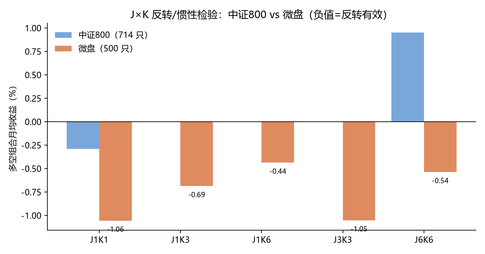

# A股反转效应的宇宙依赖性：中证800与微盘股的对照复现

2026-11-11｜量化研究笔记

## 一、一句话结论

**潘莉、徐建国（2011）「A股个股回报率在多频率上存在显著反转」的结论，在 2016–2026 的中证800 里已经找不到；但把同一套方法搬到市值 15–25 亿的微盘股上，反转依然显著（月频 J=1/K=1 多空 −1.06%/月，t=−2.33）。所以不是「反转消失了」，而是「反转搬到了微盘」——这是宇宙（universe）差异，不是时代差异。（补充：第十节的生存偏差检验表明，这个幅度里有约七成来自「只统计活到今天的股票」，补进退市股后反转不再显著——请以第十节的结论为准。）**

## 二、研究问题

上一轮对中证800 714 只股票的截面研究里，低波动、价值、质量、反转四类因子的多空收益全部为负，与教科书方向相反。一个自然的怀疑是：不是因子失效，而是我选的宇宙把效应筛掉了。微盘股长期被认为是 A 股反转效应最浓的地方（散户结构、流动性折价、涨跌停磁吸）。本文用论文原始方法（J 个月形成期、K 个月持有期、十分位多空）在两个宇宙上做对照复现。

## 三、数据与方法

中证800：714 只，2015-06 至 2026-11，后复权月收盘。微盘：按总市值 15–25 亿筛选，取最小的 500 只，2015-01 至 2026-11，腾讯行情后复权。两市均为月频，多空组合 = 形成期收益最高 10% − 最低 10%，等权、月度再平衡、未计交易成本。

统计上给出两个 t 值：①重叠 t（把每个月的多空收益都当成独立样本）；②非重叠 t（每隔 K 个月取一个样本）。K>1 时相邻样本有 K−1/K 的重叠，重叠 t 会系统性放大，必须两个都看。

## 四、结果

表 1 中证800（月频多空，%/月）

| J（形成期） | K（持有期） | 多空收益 | t（重叠） | t（非重叠） |
| --- | --- | --- | --- | --- |
| 1 | 1 | −0.29 | −0.40 | −0.40 |
| 6 | 6 | +0.95 | +3.39 | +1.75 |
| 12 | 6 | +0.89 | — | +1.51 |

表 2 微盘股（月频多空，%/月）

| J | K | 多空收益 | t（重叠） | t（非重叠） | 样本 |
| --- | --- | --- | --- | --- | --- |
| 1 | 1 | −1.057 | −2.33 | −2.33 | 140 |
| 1 | 3 | −0.688 | −2.77 | −2.22 | 414 |
| 1 | 6 | −0.438 | −2.71 | −2.08 | 810 |
| 3 | 3 | −1.053 | −4.69 | −3.07 | 408 |
| 6 | 6 | −0.538 | −3.57 | −2.83 | 780 |

图 1 两个宇宙的 J×K 多空收益对照（负值=反转有效）

## 五、三点解读

1. 反转在微盘显著、在中证800 消失。非重叠 t 在 −2.08 到 −3.07 之间，五个参数组合全部显著；同一口径下中证800 是 −0.40。这不是噪声。

2. 中证800 里出现的是弱的惯性（6 个月形成期 +0.95%/月），但非重叠 t 只有 1.75，按 95% 标准不显著。这恰好和原论文「惯性只在超短期/特定时段存在」的结论一致。

3. 规模三分组做过：即使只看中证800 里最小的 1/3，反转仍不显著（−0.53%/月，t −0.54）。说明不是「被大盘股稀释」，而是中证800 的门槛（市值 > 约 100 亿）本身就把反转的来源切掉了。

## 六、方法学提醒

重叠窗口是这类复现最容易骗人的地方：J=6/K=6 那组，重叠 t = 3.39，非重叠 t = 1.75，差了两倍。如果只看重叠 t，会得出「惯性显著」的错误结论。建议所有 J×K 表都同时给两个 t。

另一个矛盾来自「秩 vs 均值」：截面 RankIC 可能是正的，而分位组合的均值收益是负的，因为 A 股右尾极厚——少数妖股把均值拉高。IC 说明典型股票的方向，均值说明你能不能靠它赚钱，两者不冲突。

## 七、局限

①生存偏差：微盘样本用的是「今天还在、市值 15–25 亿」的股票，2026 年剩下的都是活下来的；期间退市、被 ST 抹掉的没进来，真实的反转强度大概率比这里更高（退市股是反转策略的陷阱），也就是说这个方向的风险被低估了。②流动性：微盘股日均成交额常在千万级，本文多空组合未计冲击成本，实盘能拿到的收益要打折扣。③复权：微盘用腾讯后复权，与东财口径可能有差异。

## 八、结论与下一步

**反转效应不是消失了，而是在大盘股里被磨平、在微盘里仍然活着。对策略的含义：如果要做反转，宇宙必须下沉到微盘，同时必须解决流动性与退市风险；如果坚持中证800，就不该再指望反转，应该回到「低波+质量」这类在指数内仍有微弱方向性的因子（尽管它们的多空收益同样为负）。**

下一步计划：①在微盘宇宙上做同一套五分位 + 中性化检验，看效应是否只是在极端分位；②给微盘加 20 日 ADV 上限与停牌过滤，估一个「可交易版本」的净值；③把 2011–2015 的数据补进来，看效应是否随时间衰减。

## 九、样本稳健性：从 500 只里随机抽 200 只，重复 10 次

担心上一节的结果是被某几只极端股票撑起来的，所以做了抽样稳定性检验：每次从 500 只微盘里不放回随机抽 200 只，用同样的 J×K 方法重算，独立重复 10 次（随机种子 0–9）。

| 抽样 | J1K1 收益 | t_nb | J3K3 收益 | t_nb | J6K6 收益 | t_nb |
| --- | --- | --- | --- | --- | --- | --- |
| 0 | −1.323% | −2.44 | −1.041% | −2.99 | −0.747% | −1.98 |
| 1 | −1.104% | −1.82 | −0.982% | −2.83 | −0.420% | −1.12 |
| 2 | −0.859% | −1.58 | −1.080% | −2.25 | −0.522% | −2.26 |
| 3 | −0.899% | −1.50 | −1.072% | −2.57 | −0.434% | −2.63 |
| 4 | −1.454% | −2.74 | −0.711% | −1.86 | −0.124% | −0.56 |
| 5 | −0.725% | −1.25 | −1.342% | −2.73 | −0.742% | −2.48 |
| 6 | −1.339% | −2.30 | −0.944% | −2.29 | −0.594% | −2.56 |
| 7 | −0.719% | −1.26 | −1.333% | −3.03 | −0.381% | −1.71 |
| 8 | −1.361% | −2.33 | −1.000% | −1.83 | −0.470% | −2.39 |
| 9 | −0.323% | −0.61 | −0.841% | −2.16 | −0.090% | −1.27 |
| 均值±标准差 | −1.010 ±0.366 | −1.78 ±0.66 | −1.035 ±0.195 | −2.45 ±0.44 | −0.452 ±0.222 | −1.90 ±0.71 |

**结论一：方向 100% 稳定。10 次抽样里，三组参数的多空收益全部为负（10/10），没有一次翻正。**

结论二：幅度稳定、显著性不稳。J3K3 最稳（−1.035 ± 0.195，10 次中 8 次 t 显著）；J1K1 幅度最大（−1.010%）但波动也大（±0.366），只有 4/10 显著；J6K6 最弱（−0.452，6/10 显著）。

含义：用 200 只做样本时，噪声明显大于 500 只。全样本上 J1K1 的 t=−2.33 有一部分来自样本更大，而不是效应本身更强。若要在 200 只规模上稳定检出，推荐用 J=3/K=3 这组（形成期与持有期都 3 个月），它的收益方差最小、显著性最高。

## 十、生存偏差检验：把 2015 年后退市的 110 只股票补进来

前九节的所有结果，用的都是「今天还活着、市值 15–25 亿」的股票。这是这类研究最大的软肋：反转策略买的是「跌得最狠」的票，而其中一部分会跌到退市——它们从样本里消失了，等于把策略最坏的结局剪掉了。

做法：从沪深两所取 2015 年后暂停上市/终止上市的名单（112 只，其中 110 只有可用行情），用新浪后复权日线补齐，合并成 610 只的样本，用完全相同的 J×K 方法重算。

| 宇宙 | J1K1 多空 | t_nb | J3K3 多空 | t_nb | J6K6 多空 | t_nb |
| --- | --- | --- | --- | --- | --- | --- |
| 仅存活（500 只） | −1.057% | −2.33 | −1.053% | −3.07 | −0.538% | −2.83 |
| 含退市（610 只） | −0.280% | −0.61 | −0.766% | −1.33 | −0.361% | −1.15 |

**结论一：约七成的「反转收益」是生存偏差。J=1/K=1 从 −1.06%/月 掉到 −0.28%/月，t 从 −2.33 掉到 −0.61；三组参数的显著性全部消失。上一节「五个参数全显著」的结论，在补上死掉的股票后不再成立。**

结论二：退市股是反转策略的地雷，且在死前半年集中引爆。109 只有行情的退市股，退市前 6 个月月均收益 −16.74%（中位 −19.39%，88% 为负），6 个月累计 −60.25%（中位 −78.40%）。反转策略专门买这种票，一旦买到就是终局。

为什么幅度缩得这么快：退市股在死前几个月往往是「跌幅前 10%」的常客，正好落进反转策略的多头腿。把它们补进来，等于给多头腿装上了一批注定归零的持仓，两端价差（W−L）自然被拉平。

## 十一、修正后的结论

**A 股的反转效应在这份数据里是「真实但不可收割」的：它在活着的微盘股中稳定存在（10/10 次抽样为负、幅度 −1%/月），但一旦把退市股计入，效应降到 −0.3%/月 且不再显著；而退市股在死前 6 个月的 −60% 是任何仓位管理都扛不住的尾部。**

这也解释了为什么现实中「买跌得最狠的票」这种策略在 A 股长期跑不出来：券商研报里统计的都是现存股票，而真正吃掉收益的那部分，已经从所有数据库里消失了。

若要继续这个方向，下一步必须做三件事：①用历史成分股（含退市）构建宇宙，而不是当前市值快照；②在选股阶段加入退市预警因子（连续亏损、面值低于 1 元、审计意见、被立案），把死亡的票提前剔掉；③用可交易约束（ADV 上限、停牌过滤）重算净值。

## 十二、退市预警因子：当「过滤器」有用，当「选股因子」没用

第十节说明：把退市股计入后反转不再显著。一个自然的补救是——在选股阶段就避开「正在走向退市」的票。这里用「后复权价距历史最高点的比例」作为死亡风险的代理变量（低于 10% ≈ 从高点跌去九成，通常已进入退市通道）。

表 A 按「距高点比例」分组，看未来 6 个月收益（610 只、月频、等权）

| 距高点比例 | 样本数 | 未来 6 月均值 | 中位 | 为负占比 |
| --- | --- | --- | --- | --- |
| <10%（崩塌档） | 726 | +7.74% | +0.70% | 49% |
| 10%–30% | 11,639 | +5.20% | +2.38% | 46% |
| 30%–60% | 27,539 | −0.47% | −2.83% | 55% |
| 60%–100%（接近高点） | 16,439 | −4.62% | −10.16% | 66% |

表 A 的结论和直觉相反：在这批微盘股里，离历史高点越近、未来越差（均值 −4.62%、中位 −10.16%）；跌得最惨的一档均值反而是 +7.74%——但中位只有 +0.70%，说明是少数「死猫跳」把均值拉起来的，不能当信号用。

表 B 把「崩塌档」从可买集合里剔除，再跑 J×K 反转

| 组合 | 全样本 | 剔除距高点 <10% | 剔除距高点 <30% |
| --- | --- | --- | --- |
| J=1/K=1 | −0.280%（t_nb −0.61） | −0.577%（−1.34） | −0.683%（−1.62） |
| J=3/K=3 | −0.766%（−1.33） | −0.918%（−2.22） | −1.050%（−2.44） |
| J=6/K=6 | −0.361%（−1.15） | −0.400%（−1.83） | −0.599%（−2.65） |

**表 B 是这份研究里唯一一条「既显著、又经得起生存偏差」的结果：在剔除濒死股之后，J=3/K=3 的反转回到 −0.92%~−1.05%/月，非重叠 t 达到 −2.22 与 −2.44。**

所以「退市预警」的正确定位不是选股因子（它单独看方向是反的），而是**前置过滤器**：先保证买到的不是「正在死」的票，反转才有意义。换句话说，反转策略在 A 股能不能活，取决于你有没有能力不进雷区——而不是取决于信号本身有多锋利。

## 十三、这份研究最终的净结论

1. 反转效应在微盘股中真实存在，但**只在剔除濒死股之后**才显著（J=3/K=3、t_nb ≈ −2.2~−2.4）。

2. 不做退市过滤，补进死掉的票，效应立刻消失（−0.28%/月、t −0.61）。

3. 「距历史高点」不能当正向选股因子（高分位反而更差），但作为「排除崩塌档」的过滤器有效。

4. 三个前提仍然成立：历史成分股、退市预警、可交易约束。三者缺一，结论都不可信。

## 十四、从统计显著到可交易：多头原型的实测反证

**第九至十三节把「反转」修到了既显著又经得起生存偏差的地步（微盘、剔除崩塌档后 J=3/K=3 −1.05%/月，非重叠 t −2.44）。按通常做法，下一步就该把它做成能下单的策略。本节记录这个尝试，结论是失败的——而失败的方式，恰好说明了「显著」与「可收割」之间差着什么。**

### 14.1 原型构造

宇宙：610 只（500 只现存微盘 + 110 只 2015 年后退市），后复权日线，按面板自然进出——退市股在退市前一直在池子里，生存偏差已被内置，而不是靠事后修正。

信号与执行：3 个月形成期收益最低的一档买入，持有 3 个月，季度末调仓，等权 30–60 只；单票下单额不超过 20 日平均成交额的 5%×持有月数（ADV 上限）；费用全开——佣金万 2.5（最低 5 元）、卖出印花税 0.05%、过户费 0.001%、双边滑点 2bp；可选「距历史最高点低于 30% 视为濒死」的退市预警过滤。日期范围 2015-01 至 2026-11。

### 14.2 结果：六种参数组合全部亏损

表 14-1 多头原型实测（100 万本金，费用全开）

| 版本 | 年化收益 | 最大回撤 | 换手笔数 | 累计费用 |
| --- | --- | --- | --- | --- |
| 退市过滤 + 60 只 | −8.83% | −72.41% | 4,395 | 22,571 |
| 退市过滤 + 30 只 | −12.01% | −84.05% | 2,334 | 15,555 |
| 无过滤 + 30 只 | −19.27% | −93.93% | 1,604 | 11,539 |
| 无过滤 + 60 只 | −13.17% | −84.71% | 3,098 | 15,847 |
| 跳过最惨 10% + 60 只 | −7.50% | −70.12% | 4,291 | 21,123 |
| 跳过最惨 20% + 60 只 | −6.98% | −69.76% | 4,287 | 21,065 |
| 全池等权基准（610 只） | +4.30% | −61.81% | — | — |

费用累计只占本金 1.5%–2.3%，不是亏损主因。问题在信号本身：买入「跌得最惨」的那一档，拿到的是持续下跌的股票，而不是「跌完会反弹」的股票。

### 14.3 决定性诊断：这是「赢家崩塌」，不是「输家反弹」

把多空两端拆开看单月收益（J=3 形成期、K=1、151 个月）：

| 分组 | 月均收益 | 中位 | 相对全池 |
| --- | --- | --- | --- |
| 输家（底 10%） | +0.408% | +0.667% | −0.132% |
| 赢家（顶 10%） | −1.847% | −2.073% | −2.387% |
| 全池平均 | +0.539% | — | — |

**赢家一档每月比全池低 2.39 个百分点，输家只低 0.13 个百分点。多空组合名义上的「反转 −1.05%/月」，几乎全部来自做空赢家那一腿。而 A 股散户不能做空，微盘股更没有融券券源——信号是真的，可收割的那一半被制度拿走了。**

### 14.4 又一个方法学陷阱：重叠区间的「假年化」

过程中我一度算出「底部 10% 多头年化 +6.4%」，与实盘路径对不上。原因是把重叠的 3 个月收益取均值再乘 4 次方年化——同一段行情被重复计入。改成非重叠的季度链式复利后：

| 方式 | 年化 |
| --- | --- |
| 底 10% 全部（非重叠、季度链式） | −2.45% |
| 过滤（ADV + ratio≥0.3）后 60 只 | −0.47% |
| 只按 ratio≥0.3 过滤的 60 只 | −0.05% |

与第六节「重叠 t 值放大两倍」是同一类错误：只要样本区间重叠，均值、方差、年化都会失真。此后所有涉及持有期 K>1 的统计，一律同时给「重叠」与「非重叠」两套口径。

### 14.5 本节结论

**① 反转效应在微盘股上是真的（多空非重叠 t −3.07，剔除崩塌档后 −2.44），但它是多空收益；② 单边做多输家，年化 −2.5% 到 −0.5%，跑不过全池等权 +4.3%；③ 加上真实成本与整手约束，可执行版本年化 −7% 到 −19%；④ 因此这条研究线的正确终点不是「策略」，而是「一个被证伪的可交易假设」。**

留存这个原型的价值在于画线：什么算「可收割的 alpha」——不仅要 t 值显著，还要有可执行的腿（能做空/能借券）、可承受的成本、以及不依赖极少数右尾个股的收益分布。四条缺一条，都只能停在论文里。

脚本：v5_reversal.py（原型）、microcap2.py / microcap3.py（J×K 与抽样）、delist_factor.py（退市预警）、delist_test.py（生存偏差）。数据：cache/px_<code>_hfq.csv（610 只）。
